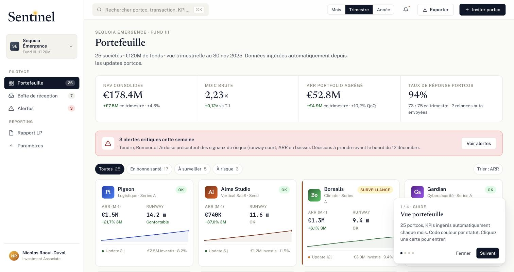

# Sentinel

Prototype d'outil de suivi de portefeuille pour fonds de VC et de PE : les participations remontent leurs indicateurs, le fonds voit son portefeuille consolidé, ses alertes et ses reportings investisseurs au même endroit.

**[Ouvrir la démo](https://nicolasraoulduval-ui.github.io/sentinel-site/)**

## Le problème

Dans un fonds, le suivi des participations se fait encore largement par email et tableur : relances pour obtenir les chiffres, consolidation à la main, reportings LP reconstruits chaque trimestre. Sentinel montre à quoi ressemblerait ce suivi centralisé.

## Ce que montre la démo

- Collecte des indicateurs auprès des participations : ARR, MRR, burn, runway, effectifs
- Vue consolidée du portefeuille : NAV, MOIC brut, ARR agrégé, taux de réponse
- Alertes sur les situations critiques : runway inférieur à 6 mois, ARR en baisse
- Reporting LP, y compris les éléments réglementaires (SFDR articles 8 et 9, PAI)
- Table de capitalisation et cascade de liquidation par participation

Les données affichées sont fictives.

## Stack

Prototype en une page HTML, CSS et JavaScript, sans backend.
